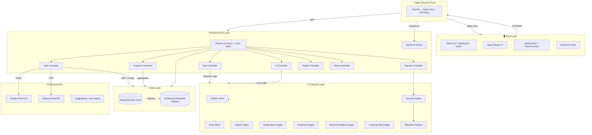
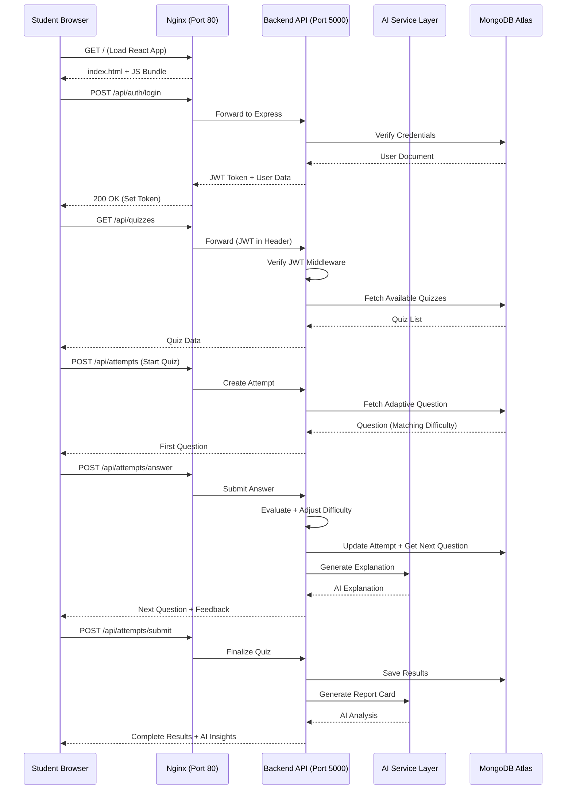
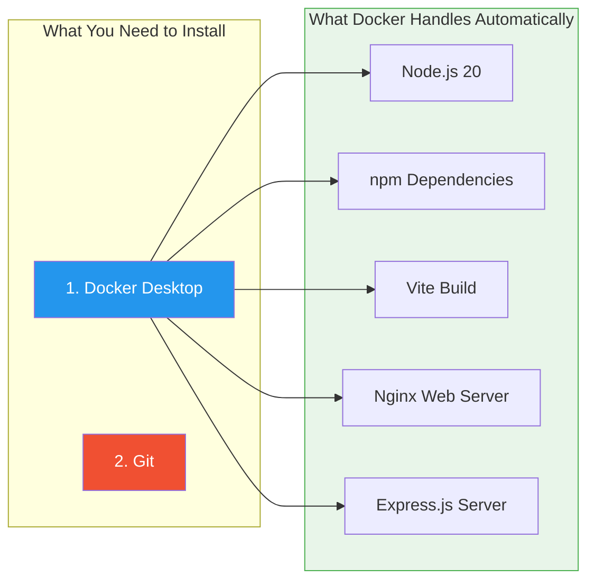
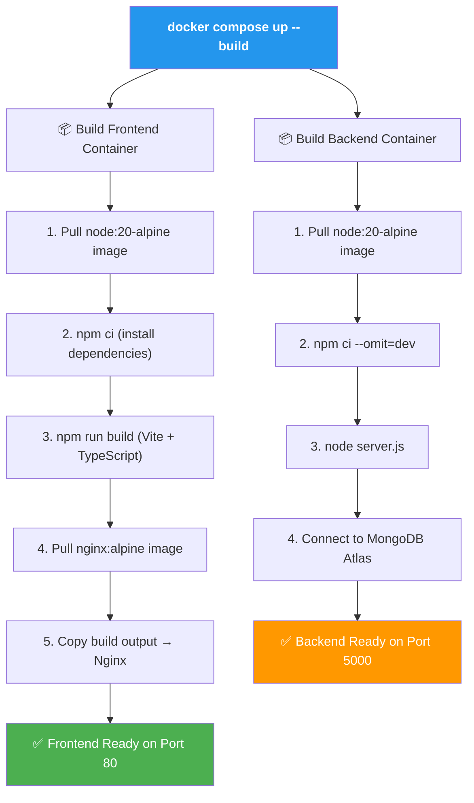
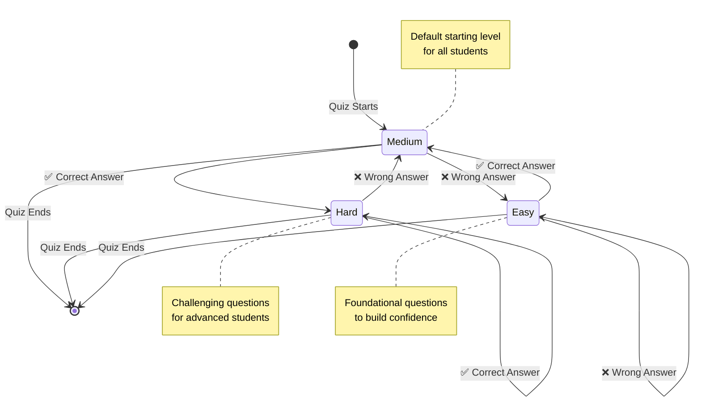
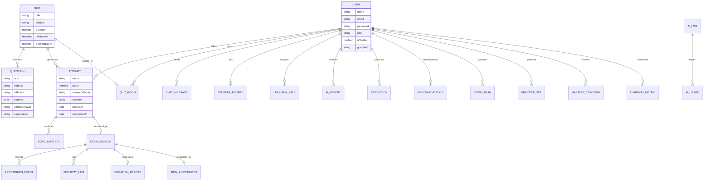
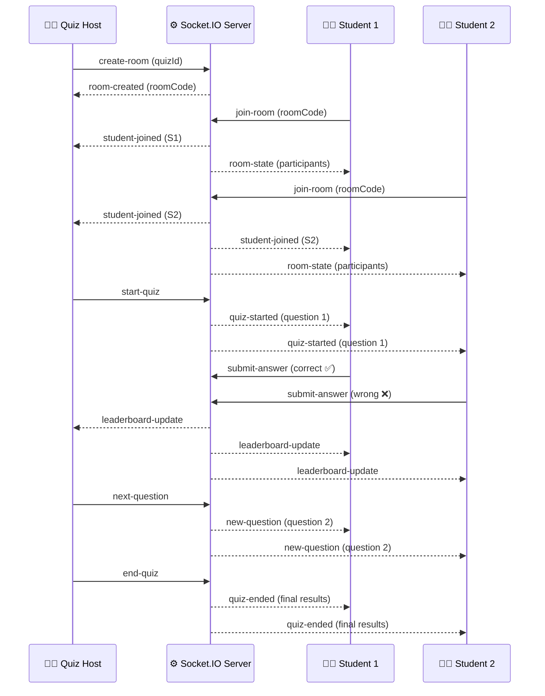
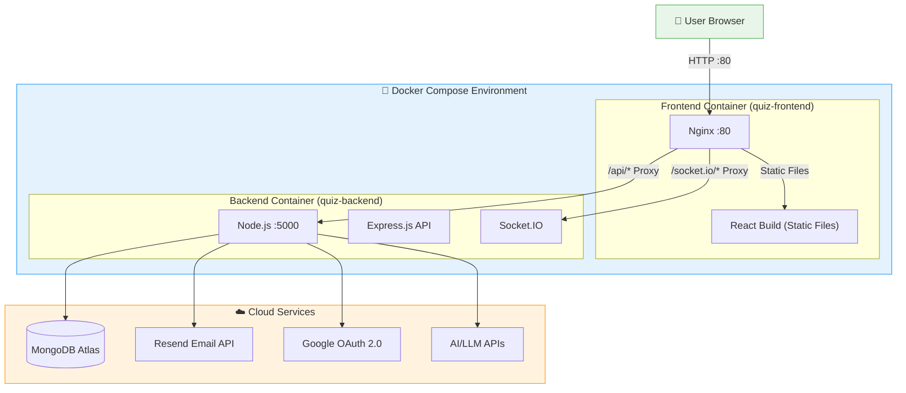

# 🧠 AI Adaptive Quiz Platform

> An intelligent, enterprise-grade full-stack assessment platform featuring a dynamic **AI-driven Adaptive Difficulty Evaluation Engine**, **Real-Time Multiplayer Quiz Rooms**, **AI-Powered Analytics & Proctoring**, **Google OAuth 2.0**, **Email OTP Verification**, and **Comprehensive Performance Dashboards**.

Built on the modern **MERN stack** (MongoDB, Express, React 19, Node.js) with TypeScript and Tailwind CSS v4. The platform evaluates student mastery in real-time — dynamically scaling question difficulty up or down based on individual answer accuracy, while providing administrators with deep AI-powered analytics and security monitoring.

[](https://nodejs.org/)
[](https://react.dev/)
[](https://www.mongodb.com/atlas)
[](https://docs.docker.com/compose/)
[](https://socket.io/)
[](LICENSE)

---

## 📑 Table of Contents

- [Key Features](#-key-features)
- [System Architecture](#-system-architecture)
- [Tech Stack](#-tech-stack)
- [Project Structure](#-project-structure)
- [Getting Started](#-getting-started)
  - [Prerequisites](#-prerequisites)
  - [Option 1: Docker Setup (Recommended)](#-option-1-docker-setup-recommended)
  - [Option 2: Manual Setup](#-option-2-manual-setup)
- [Environment Variables](#-environment-variables)
- [Running the Application](#-running-the-application)
- [Adaptive Engine Flow](#-adaptive-engine-flow)
- [API Documentation](#-api-endpoint-documentation)
- [Database Schema](#-database-schema)
- [AI Services Architecture](#-ai-services-architecture)
- [Real-Time Features](#-real-time-features)
- [Demo Accounts](#-pre-seeded-demo-accounts)
- [Deployment Architecture](#-deployment-architecture)
- [Contributing](#-contributing)
- [License](#-license)

---

## 🌟 Key Features

### 👤 Authentication & Security
- **Email OTP Verification**: Secure 6-digit email OTP delivery powered by **Resend API** with auto-expiration, attempt limits, and disposable email detection
- **Google OAuth 2.0**: Seamless single sign-on (SSO) using `@react-oauth/google` and server-side Google token verification
- **JWT & Role-Based Access Control**: Secure JSON Web Token authentication with **Student** and **Admin** roles, encrypted passwords via `bcryptjs`
- **AI-Powered Proctoring**: Real-time behavioral analysis detecting tab switches, copy-paste, idle time, and suspicious patterns during exams
- **Security Dashboard**: Comprehensive violation tracking, risk assessment, and security event logging

### 🧠 Dynamic AI Adaptive Engine
- **Real-Time Difficulty Adjustment**:
  - Starts each session at **Medium** difficulty
  - Correct answers elevate difficulty (`Easy` → `Medium` → `Hard`)
  - Incorrect answers lower difficulty (`Hard` → `Medium` → `Easy`)
- **Topic Mastery Tracking**: Per-topic proficiency evaluation across subjects and sub-topics
- **Dynamic Question Selection**: Fetches unvisited questions matching current difficulty tier in real-time
- **AI Study Plan Generator**: Analyzes weak areas and generates customized study recommendations
- **AI Question & Quiz Generation**: Administrators can auto-generate questions and quizzes using AI (Groq/OpenAI/Gemini)

### 🎮 Real-Time Multiplayer Quiz Rooms
- **Live Quiz Hosting**: Admins create rooms, students join via room codes
- **Real-Time Leaderboard**: Live score updates via Socket.IO
- **Synchronized Gameplay**: All participants progress through questions simultaneously
- **Host Controls**: Start, pause, skip, and end quiz sessions in real-time

### 📊 Advanced Analytics & AI Insights
- **Student Analytics**: Visual progress graphs, mastery percentages, accuracy rates, learning velocity
- **Admin Analytics**: Aggregate class performance, subject difficulty distributions, completion rates
- **AI-Powered Insights**: Automated performance predictions, student segmentation, risk assessments
- **AI Report Cards**: Comprehensive AI-generated student evaluation reports
- **PDF Report Generation**: Downloadable performance reports via PDFKit/jsPDF

### 🤖 AI Tutor & Learning Tools
- **Interactive AI Tutor**: Chat-based learning assistant for personalized help
- **Personalized Learning Paths**: AI-generated study roadmaps based on performance
- **Practice Quiz Generator**: Adaptive practice sets targeting weak areas
- **Detailed Explanations**: AI-generated explanations for correct/incorrect answers

### ⚡ Resilient Backend Architecture
- **Dual Database Strategy**: MongoDB Atlas Cloud with automatic fallback to **In-Memory MongoDB** for zero startup failures
- **Real-Time Communication**: Socket.IO for live quiz updates, leaderboards, and monitoring
- **Document Processing**: PDF/CSV parsing for bulk question and student imports

---

## 🏗️ System Architecture

### High-Level Architecture Overview



### Request-Response Data Flow



---

## 🛠️ Tech Stack

| Domain | Technology | Version |
|--------|-----------|---------|
| **Frontend Framework** | React with TypeScript | 19.x |
| **Build Tool** | Vite | 8.x |
| **Routing** | React Router | v7 |
| **Styling** | Tailwind CSS | v4 |
| **Icons** | Lucide React | Latest |
| **Charts** | Recharts | v3 |
| **Backend Runtime** | Node.js | 20+ |
| **Backend Framework** | Express.js | v4 |
| **Real-Time** | Socket.IO | v4.8 |
| **Database** | MongoDB Atlas + Mongoose | v8 |
| **DB Fallback** | MongoDB Memory Server | v11 |
| **Auth** | JWT + bcryptjs + Google OAuth 2.0 | — |
| **Email** | Resend API | — |
| **AI/LLM** | Groq / OpenAI / Google Gemini | — |
| **PDF Generation** | PDFKit (server) + jsPDF (client) | — |
| **PDF Parsing** | pdf-parse | — |
| **Containerization** | Docker + Docker Compose | v3.8 |
| **Web Server** | Nginx (production) | Alpine |

---

## 📂 Project Structure

```text
ai-adaptive-quiz-platform/
│
├── 🐳 Docker Configuration
│   ├── Dockerfile                      # Frontend multi-stage build (Vite → Nginx)
│   ├── docker-compose.yml              # Orchestrates frontend + backend services
│   ├── nginx.conf                      # Nginx reverse proxy + SPA routing
│   └── .dockerignore                   # Docker build exclusions
│
├── 📦 server/                          # Express.js Backend API
│   ├── Dockerfile                      # Backend container configuration
│   ├── .dockerignore                   # Backend Docker exclusions
│   ├── server.js                       # Application entrypoint
│   ├── socket.js                       # Socket.IO event handlers
│   ├── .env.example                    # Environment variable template
│   │
│   ├── config/
│   │   └── db.js                       # MongoDB connection + memory fallback
│   │
│   ├── controllers/
│   │   ├── authController.js           # Register, Login, OTP, Google OAuth
│   │   ├── quizController.js           # Quiz CRUD operations
│   │   ├── questionController.js       # Question bank management
│   │   ├── attemptController.js        # Quiz attempt lifecycle + adaptive logic
│   │   ├── roomController.js           # Multiplayer room management
│   │   ├── aiController.js             # AI tutor, study plans, explanations
│   │   ├── aiGenerationController.js   # AI question/quiz generation
│   │   ├── aiAnalyticsController.js    # AI-powered analytics endpoints
│   │   ├── analyticsController.js      # Performance analytics aggregation
│   │   ├── reportController.js         # PDF report generation
│   │   └── securityController.js       # Proctoring & violation management
│   │
│   ├── models/                         # Mongoose Schemas (23 models)
│   │   ├── userModel.js                # User accounts (Student/Admin)
│   │   ├── quizModel.js                # Quiz definitions
│   │   ├── questionModel.js            # Question bank entries
│   │   ├── attemptModel.js             # Quiz attempt records
│   │   ├── quizRoomModel.js            # Multiplayer quiz rooms
│   │   ├── chatMessageModel.js         # AI tutor chat history
│   │   ├── aiLogModel.js               # AI service usage logs
│   │   ├── aiReportModel.js            # AI-generated report cards
│   │   ├── aiUsageModel.js             # AI API usage tracking
│   │   ├── examSessionModel.js         # Exam session proctoring data
│   │   ├── learningMetricModel.js      # Learning performance metrics
│   │   ├── learningPathModel.js        # Personalized learning paths
│   │   ├── masteryTrackingModel.js     # Topic mastery tracking
│   │   ├── practiceSetModel.js         # Practice quiz sets
│   │   ├── predictionModel.js          # AI performance predictions
│   │   ├── proctoringEventModel.js     # Proctoring event records
│   │   ├── recommendationModel.js      # AI study recommendations
│   │   ├── riskAssessmentModel.js      # Student risk assessments
│   │   ├── securityLogModel.js         # Security event logs
│   │   ├── studentProfileModel.js      # Extended student profiles
│   │   ├── studyPlanModel.js           # AI-generated study plans
│   │   ├── topicMasteryModel.js        # Per-topic mastery data
│   │   └── violationReportModel.js     # Exam violation reports
│   │
│   ├── services/                       # Business Logic & AI Engines (24 services)
│   │   ├── aiService.js                # Core AI service orchestrator
│   │   ├── geminiClient.js             # Google Gemini API client
│   │   ├── groqClient.js               # Groq API client
│   │   ├── questionGenerator.js        # AI question generation
│   │   ├── quizGenerator.js            # AI quiz generation
│   │   ├── explanationEngine.js        # AI answer explanations
│   │   ├── explanationGenerator.js     # Explanation formatting
│   │   ├── recommendationEngine.js     # Study recommendations
│   │   ├── learningPathEngine.js       # Learning path generation
│   │   ├── predictionEngine.js         # Performance prediction
│   │   ├── practiceGenerator.js        # Practice set creation
│   │   ├── practiceSetEngine.js        # Practice set logic
│   │   ├── masteryTracker.js           # Mastery level tracking
│   │   ├── analyticsEngine.js          # Analytics computation
│   │   ├── insightGenerator.js         # AI insight generation
│   │   ├── segmentationEngine.js       # Student segmentation
│   │   ├── skillAnalyzer.js            # Skill gap analysis
│   │   ├── questionAnalyzer.js         # Question quality analysis
│   │   ├── quizAnalyzer.js             # Quiz effectiveness analysis
│   │   ├── studyPlanGenerator.js       # Study plan creation
│   │   ├── securityEngine.js           # Security analysis engine
│   │   ├── behaviorAnalyzer.js         # Student behavior detection
│   │   ├── contentExtractor.js         # Document content extraction
│   │   └── pdfReportGenerator.js       # PDF report creation
│   │
│   ├── middleware/
│   │   └── authMiddleware.js           # JWT verification + role protection
│   │
│   ├── routes/                         # API Route Definitions
│   │   ├── authRoutes.js               # /api/auth/*
│   │   ├── quizRoutes.js               # /api/quizzes/*
│   │   ├── questionRoutes.js           # /api/questions/*
│   │   ├── attemptRoutes.js            # /api/attempts/*
│   │   ├── roomRoutes.js               # /api/rooms/*
│   │   ├── aiRoutes.js                 # /api/ai/*
│   │   ├── aiAnalyticsRoutes.js        # /api/ai-analytics/*
│   │   ├── analyticsRoutes.js          # /api/analytics/*
│   │   ├── reportRoutes.js             # /api/reports/*
│   │   └── securityRoutes.js           # /api/security/*
│   │
│   └── utils/
│       ├── emailService.js             # Resend API email delivery
│       ├── emailValidator.js           # Disposable email detection
│       └── documentParser.js           # PDF/CSV document parsing
│
├── 🎨 src/                             # React Frontend Application
│   ├── main.tsx                        # React DOM entry + Google OAuth Provider
│   ├── App.tsx                         # Route definitions + layout
│   ├── App.css                         # Global styles
│   ├── index.css                       # Tailwind CSS base + custom styles
│   │
│   ├── context/
│   │   ├── AuthContext.tsx             # Authentication state management
│   │   └── ThemeContext.tsx            # Dark/light theme toggle
│   │
│   ├── components/
│   │   ├── Navbar.tsx                  # Navigation bar with role-based menus
│   │   ├── GoogleAuthButton.tsx        # Google OAuth login button
│   │   ├── OTPVerificationModal.tsx    # Email OTP input modal
│   │   ├── QuestionForm.tsx            # Question creation/editing form
│   │   ├── QuizForm.tsx                # Quiz creation/editing form
│   │   ├── FormattedQuestionText.tsx   # Rich question text renderer
│   │   ├── PerformanceChart.tsx        # Recharts performance visualization
│   │   ├── StatsCard.tsx               # Statistics display card
│   │   ├── GlassCard.tsx               # Glassmorphism UI card
│   │   ├── LoadingSpinner.tsx          # Loading indicator
│   │   ├── AIServiceDownModal.tsx      # AI service unavailable notification
│   │   └── StudentDocumentImportModal.tsx # CSV/PDF student import
│   │
│   ├── pages/
│   │   ├── LandingPage.tsx             # Public landing page
│   │   ├── LoginPage.tsx               # User login
│   │   ├── RegisterPage.tsx            # User registration with OTP
│   │   ├── StudentDashboard.tsx        # Student home dashboard
│   │   ├── StudentAnalytics.tsx        # Student performance analytics
│   │   ├── QuizPage.tsx                # Live quiz taking interface
│   │   ├── ResultPage.tsx              # Quiz results & AI feedback
│   │   ├── PracticeQuiz.tsx            # AI-generated practice quizzes
│   │   ├── LearningPath.tsx            # Personalized learning roadmap
│   │   ├── AITutor.tsx                 # Interactive AI tutor chat
│   │   ├── AIReportCard.tsx            # AI-generated report card
│   │   ├── AdminDashboard.tsx          # Admin management home
│   │   ├── AdminQuestions.tsx          # Question bank management
│   │   ├── AdminQuizzes.tsx            # Quiz management
│   │   ├── AdminAnalytics.tsx          # Platform-wide analytics
│   │   ├── AdminAIInsights.tsx         # AI-powered admin insights
│   │   ├── AdminAIQuestionGenerator.tsx # AI question generation tool
│   │   ├── AdminAIQuizGenerator.tsx    # AI quiz generation tool
│   │   ├── AdminIntelligenceDashboard.tsx # Advanced AI analytics
│   │   ├── AdminSecurityDashboard.tsx  # Proctoring & security monitoring
│   │   ├── HostLobby.tsx              # Quiz room host controls
│   │   ├── StudentJoin.tsx            # Join quiz room interface
│   │   ├── StudentLobby.tsx           # Quiz room student view
│   │   └── LiveDashboard.tsx          # Real-time quiz monitoring
│   │
│   ├── services/
│   │   ├── api.ts                     # Axios API client configuration
│   │   ├── socket.ts                  # Socket.IO client setup
│   │   └── layaService.ts             # HuggingFace Laya integration
│   │
│   ├── hooks/                         # Custom React hooks
│   ├── layouts/                       # Layout components
│   ├── utils/                         # Frontend utility functions
│   └── assets/                        # Static assets
│
├── 🤗 hf-laya-space/                  # HuggingFace Space (Laya AI)
│   ├── app.py                         # FastAPI/Gradio AI service
│   └── requirements.txt               # Python dependencies
│
├── index.html                         # Vite HTML entry point
├── vite.config.ts                     # Vite build configuration
├── tsconfig.json                      # TypeScript configuration
├── eslint.config.js                   # ESLint configuration
├── package.json                       # Frontend dependencies
├── .gitignore                         # Git exclusions
└── README.md                          # This file
```

---

## 🚀 Getting Started

### 📋 Prerequisites

| Requirement | Version | Required For |
|-------------|---------|-------------|
| **Docker Desktop** | Latest | Docker setup (Option 1) |
| **Docker Compose** | v2+ | Docker setup (Option 1) |
| **Node.js** | v20+ | Manual setup (Option 2) |
| **npm** | v9+ | Manual setup (Option 2) |
| **Git** | Latest | Both options |

---

### 🐳 Option 1: Docker Setup (Recommended)

Docker is the **recommended way** to run this project. It packages the entire application (frontend, backend, and all dependencies) into isolated containers — **no need to install Node.js, npm, or MongoDB on your machine**. Just install Docker and run one command.



---

#### 📘 Step 1: Install Docker Desktop

<details>
<summary><b>🪟 Windows Installation (Click to expand)</b></summary>

**1.1 — Check System Requirements:**
- Windows 10 version 2004+ (Build 19041+) or Windows 11
- 64-bit processor with BIOS-level virtualization enabled
- At least 4 GB RAM

**1.2 — Enable WSL 2 (Windows Subsystem for Linux):**

Open **PowerShell as Administrator** and run:
```powershell
wsl --install
```
> This installs WSL 2 with Ubuntu. **Restart your PC** after this step.

After restart, verify WSL is working:
```powershell
wsl --version
```
Expected output:
```
WSL version: 2.x.x.x
Kernel version: 5.x.x.x
```

**1.3 — Download Docker Desktop:**

1. Go to 👉 [https://www.docker.com/products/docker-desktop/](https://www.docker.com/products/docker-desktop/)
2. Click **"Download for Windows"**
3. Run the installer (`Docker Desktop Installer.exe`)
4. During installation, ensure these options are **checked**:
   - ✅ Use WSL 2 instead of Hyper-V
   - ✅ Add shortcut to desktop
5. Click **Install** → Wait for completion → Click **Close and restart**

**1.4 — Start Docker Desktop:**

1. Open **Docker Desktop** from the Start Menu or Desktop shortcut
2. Wait for the Docker engine to start (the whale icon in the system tray will stop animating)
3. Accept the Docker Subscription Service Agreement if prompted

**1.5 — Verify Docker Installation:**

Open a **new PowerShell or Command Prompt** window and run:
```powershell
docker --version
```
Expected output:
```
Docker version 27.x.x, build xxxxxxx
```

```powershell
docker compose version
```
Expected output:
```
Docker Compose version v2.x.x
```

**1.6 — Test Docker is Working:**
```powershell
docker run hello-world
```
Expected output:
```
Hello from Docker!
This message shows that your installation appears to be working correctly.
```

> ⚠️ **If you see errors**: Make sure Docker Desktop is running (check the whale icon in system tray). If you see "WSL 2 installation is incomplete", run `wsl --update` in PowerShell as Administrator.

</details>

<details>
<summary><b>🍎 macOS Installation (Click to expand)</b></summary>

**Option A — Download from website:**
1. Go to 👉 [https://www.docker.com/products/docker-desktop/](https://www.docker.com/products/docker-desktop/)
2. Click **"Download for Mac"** (choose Apple Silicon or Intel)
3. Open the `.dmg` file and drag Docker to Applications
4. Open Docker from Applications → Accept the agreement

**Option B — Install via Homebrew:**
```bash
brew install --cask docker
```

**Verify:**
```bash
docker --version          # Docker version 27.x.x
docker compose version    # Docker Compose version v2.x.x
docker run hello-world    # Should print "Hello from Docker!"
```

</details>

<details>
<summary><b>🐧 Linux (Ubuntu/Debian) Installation (Click to expand)</b></summary>

```bash
# Update packages
sudo apt update

# Install Docker
sudo apt install docker.io docker-compose-v2 -y

# Enable Docker to start on boot
sudo systemctl enable docker
sudo systemctl start docker

# Add your user to the docker group (avoids needing sudo)
sudo usermod -aG docker $USER

# Log out and log back in, then verify:
docker --version          # Docker version 27.x.x
docker compose version    # Docker Compose version v2.x.x
docker run hello-world    # Should print "Hello from Docker!"
```

</details>

---

#### 📘 Step 2: Install Git (if not already installed)

<details>
<summary><b>Check if Git is installed (Click to expand)</b></summary>

```bash
git --version
```

If you see `git version 2.x.x`, you're good. If not:

| OS | Install Command |
|----|----------------|
| **Windows** | Download from [git-scm.com/download/win](https://git-scm.com/download/win) and run installer |
| **macOS** | `xcode-select --install` or `brew install git` |
| **Linux** | `sudo apt install git -y` |

</details>

---

#### 📘 Step 3: Clone the Repository

Open a terminal (PowerShell on Windows, Terminal on macOS/Linux):

```bash
git clone https://github.com/SaiNanduVajhala/AI_QUIZ_MAJOR.git
```

Navigate into the project folder:
```bash
cd AI_QUIZ_MAJOR
```

Verify you're in the right directory:
```bash
ls
```
You should see files like `Dockerfile`, `docker-compose.yml`, `package.json`, `server/`, `src/`, etc.

---

#### 📘 Step 4: Configure Environment Variables

The backend needs API keys and database credentials to run. Copy the template and fill in your values:

```bash
cd server
cp .env.example .env
```

Now edit the `server/.env` file with a text editor:

**On Windows (Notepad):**
```powershell
notepad .env
```

**On macOS/Linux:**
```bash
nano .env
```

Fill in the required values:
```env
# ✅ REQUIRED — Server Port
PORT=5000

# ✅ REQUIRED — MongoDB Atlas Connection String
# Get this from: https://cloud.mongodb.com → Connect → Drivers
MONGODB_URI=mongodb+srv://<username>:<password>@<cluster>.mongodb.net/<dbname>

# ✅ REQUIRED — JWT Secret (any random string)
JWT_SECRET=your_secret_key_here

# 📧 OPTIONAL — Email OTP (get key from https://resend.com)
RESEND_API_KEY=
RESEND_FROM_EMAIL=onboarding@resend.dev

# 🔐 OPTIONAL — Google OAuth (https://console.cloud.google.com)
VITE_GOOGLE_CLIENT_ID=

# 🤖 OPTIONAL — AI Features (at least one for AI to work)
GROQ_API_KEY=
OPENAI_API_KEY=
```

Save and close the file. Return to the project root:
```bash
cd ..
```

---

#### 📘 Step 5: Build and Run with Docker Compose

This is the **main command** that builds and starts everything:

```bash
docker compose up --build
```

> ⏱️ **First run takes 3-5 minutes** (downloads Node.js images, installs npm packages, builds the React app). Subsequent runs are much faster due to Docker's layer caching.

**What this single command does:**



**You'll see output like this in your terminal:**
```
[+] Building 120.5s (19/19) FINISHED
 => [frontend] => npm ci                                    45.2s
 => [frontend] => npm run build                             30.1s
 => [backend]  => npm ci --omit=dev                         25.3s
[+] Running 3/3
 ✔ Network ai_quiz_major_quiz-network  Created              0.1s
 ✔ Container quiz-backend              Started              1.2s
 ✔ Container quiz-frontend             Started              1.5s

quiz-backend   | ✅ MongoDB Connected: cluster0-shard-00-02.xxxxx.mongodb.net
quiz-backend   | ✅ Server running on port 5000
```

> When you see `✅ Server running on port 5000`, the application is ready!

---

#### 📘 Step 6: Access the Application

| What | URL | Description |
|------|-----|-------------|
| 🌐 **Web Application** | [`http://localhost`](http://localhost) | Main application (login, quizzes, dashboards) |
| ⚙️ **Backend API** | [`http://localhost:5000`](http://localhost:5000) | API health check |
| 🔌 **API Endpoints** | `http://localhost/api/*` | All API calls (proxied through Nginx) |

**Container Status Overview:**

| Container | Name | Port | Role |
|-----------|------|------|------|
| 🎨 Frontend | `quiz-frontend` | `80` | Nginx serves React app + proxies API calls |
| ⚙️ Backend | `quiz-backend` | `5000` | Express.js REST API + Socket.IO |
| ☁️ Database | MongoDB Atlas | Cloud | Persistent data storage (no container needed) |

---

#### 📘 Step 7: Stopping and Managing Containers

**Stop the application** (press `Ctrl + C` in the terminal where it's running, or):
```bash
docker compose down
```

**Start again** (faster after first build):
```bash
docker compose up
```

**Rebuild after code changes:**
```bash
docker compose up --build
```

---

#### 📖 Docker Commands Quick Reference

| Command | What It Does |
|---------|-------------|
| `docker compose up --build` | Build images and start all containers |
| `docker compose up --build -d` | Same, but run in **background** (detached) |
| `docker compose down` | Stop and remove all containers |
| `docker compose ps` | Show status of all containers |
| `docker compose logs -f` | View live logs from all services |
| `docker compose logs -f backend` | View live logs from backend only |
| `docker compose logs -f frontend` | View live logs from frontend only |
| `docker compose restart backend` | Restart only the backend container |
| `docker compose build backend` | Rebuild only the backend image |
| `docker compose down --rmi all` | Stop + remove all containers and images |

---

#### 🔧 Troubleshooting Docker Issues

<details>
<summary><b>❌ "docker: command not found"</b></summary>

- **Windows**: Make sure Docker Desktop is installed and running. Open a **new** terminal after installation.
- **Linux**: Run `sudo apt install docker.io -y && sudo systemctl start docker`
- **macOS**: Open Docker from Applications first, then try again.

</details>

<details>
<summary><b>❌ "Cannot connect to the Docker daemon"</b></summary>

Docker Desktop is not running. Start it:
- **Windows/macOS**: Open Docker Desktop from Start Menu / Applications
- **Linux**: `sudo systemctl start docker`

</details>

<details>
<summary><b>❌ "Port 80 is already in use"</b></summary>

Another application (like IIS, Apache, or Skype) is using port 80. Either:
1. Stop the conflicting application, or
2. Change the frontend port in `docker-compose.yml`:
```yaml
ports:
  - "3000:80"    # Changed from "80:80" to "3000:80"
```
Then access the app at `http://localhost:3000`

</details>

<details>
<summary><b>❌ "Port 5000 is already in use"</b></summary>

Another application is using port 5000. Change the backend port in `docker-compose.yml`:
```yaml
ports:
  - "5001:5000"    # Changed from "5000:5000" to "5001:5000"
```

</details>

<details>
<summary><b>❌ "MongoDB connection failed"</b></summary>

1. Check that `MONGODB_URI` in `server/.env` is correct
2. Check your MongoDB Atlas cluster allows connections from any IP:
   - Go to MongoDB Atlas → Network Access → Add `0.0.0.0/0` (allow from anywhere)
3. Check your MongoDB Atlas username/password are correct

</details>

<details>
<summary><b>❌ Build fails with "npm ci" errors</b></summary>

Try cleaning Docker's build cache:
```bash
docker compose down
docker system prune -f
docker compose up --build
```

</details>

<details>
<summary><b>❌ WSL 2 errors on Windows</b></summary>

1. Open PowerShell as Administrator
2. Run: `wsl --update`
3. Run: `wsl --set-default-version 2`
4. Restart Docker Desktop

</details>

---

### 🔧 Option 2: Manual Setup

If you prefer running without Docker, follow these steps:

#### Step 1: Clone the Repository
```bash
git clone https://github.com/SaiNanduVajhala/AI_QUIZ_MAJOR.git
cd AI_QUIZ_MAJOR
```

#### Step 2: Install & Configure Backend
```bash
cd server
cp .env.example .env
# Edit server/.env with your credentials
npm install
```

#### Step 3: Install Frontend Dependencies
```bash
cd ..
npm install
```

#### Step 4: Start the Application

**Terminal 1 — Backend (Port 5000):**
```bash
cd server
npm run dev
```

**Terminal 2 — Frontend (Port 5173):**
```bash
# From project root
npm run dev
```

Open [`http://localhost:5173`](http://localhost:5173) in your browser.

---

## 🔐 Environment Variables

Create `server/.env` from the template:

```env
# Server Configuration
PORT=5000

# MongoDB Connection (Atlas Cloud)
MONGODB_URI=mongodb+srv://<username>:<password>@<cluster>.mongodb.net/<dbname>

# JWT Authentication Secret
JWT_SECRET=your_secure_random_string_here

# Email OTP Verification (Resend API)
# Get your key at: https://resend.com
RESEND_API_KEY=re_xxxxxxxxxxxxxxxxxxxx
RESEND_FROM_EMAIL=onboarding@resend.dev

# Google OAuth 2.0 Client ID
# Set up at: https://console.cloud.google.com/apis/credentials
VITE_GOOGLE_CLIENT_ID=your_client_id.apps.googleusercontent.com

# AI/LLM API Keys (at least one required for AI features)
# Groq: https://console.groq.com
GROQ_API_KEY=gsk_xxxxxxxxxxxxxxxxxxxx

# OpenAI: https://platform.openai.com/api-keys
OPENAI_API_KEY=sk-xxxxxxxxxxxxxxxxxxxx
```

> **Note**: The platform works without AI keys — AI features (tutor, question generation, insights) will be unavailable but core quiz functionality remains fully operational.

---

## 🏃 Running the Application

### Docker Mode
```bash
docker compose up --build
# App available at http://localhost
```

### Development Mode
```bash
# Terminal 1: Backend
cd server && npm run dev

# Terminal 2: Frontend
npm run dev
# App available at http://localhost:5173
```

---

## 🔄 Adaptive Engine Flow

The core of the platform is the **AI Adaptive Difficulty Engine** that dynamically adjusts question difficulty based on student performance in real-time:



### How It Works

1. **Session Initialization**: Every quiz attempt begins at **Medium** difficulty
2. **Answer Evaluation**: After each response, the engine evaluates correctness
3. **Difficulty Adjustment**: The difficulty level shifts up or down based on the answer
4. **Question Selection**: The next question is fetched from the bank matching the new difficulty level and the quiz topic — excluding previously seen questions
5. **Mastery Calculation**: At quiz completion, per-topic mastery scores are computed from the weighted performance across difficulty tiers
6. **AI Analysis**: Results are fed into the AI service layer for generating study plans, predictions, and recommendations

---

## 🔌 API Endpoint Documentation

### 🔑 Authentication (`/api/auth`)

| Method | Endpoint | Description | Access |
|--------|----------|-------------|--------|
| `POST` | `/api/auth/register` | Register new user account | Public |
| `POST` | `/api/auth/login` | Login with email & password | Public |
| `POST` | `/api/auth/send-otp` | Send 6-digit OTP to email | Public |
| `POST` | `/api/auth/verify-otp` | Verify OTP code | Public |
| `POST` | `/api/auth/google` | Google OAuth authentication | Public |

### ❓ Question Bank (`/api/questions`)

| Method | Endpoint | Description | Access |
|--------|----------|-------------|--------|
| `GET` | `/api/questions` | List questions (with filters) | Admin |
| `POST` | `/api/questions` | Create new question | Admin |
| `PUT` | `/api/questions/:id` | Update question | Admin |
| `DELETE` | `/api/questions/:id` | Delete question | Admin |

### 📝 Quizzes (`/api/quizzes`)

| Method | Endpoint | Description | Access |
|--------|----------|-------------|--------|
| `GET` | `/api/quizzes` | Fetch available quizzes | Authenticated |
| `POST` | `/api/quizzes` | Create quiz blueprint | Admin |

### 🎯 Quiz Attempts (`/api/attempts`)

| Method | Endpoint | Description | Access |
|--------|----------|-------------|--------|
| `POST` | `/api/attempts` | Start new quiz attempt | Student |
| `POST` | `/api/attempts/answer` | Submit answer + get next adaptive question | Student |
| `POST` | `/api/attempts/submit` | Finalize quiz + get results | Student |
| `GET` | `/api/results/:userId` | Get user's quiz results history | Student |

### 🎮 Quiz Rooms (`/api/rooms`)

| Method | Endpoint | Description | Access |
|--------|----------|-------------|--------|
| `POST` | `/api/rooms` | Create multiplayer quiz room | Admin |
| `GET` | `/api/rooms/:code` | Get room by join code | Authenticated |

### 🤖 AI Services (`/api/ai`)

| Method | Endpoint | Description | Access |
|--------|----------|-------------|--------|
| `POST` | `/api/ai/generate-questions` | AI question generation | Admin |
| `POST` | `/api/ai/generate-quiz` | AI quiz generation | Admin |
| `POST` | `/api/ai/explain` | AI answer explanation | Student |
| `POST` | `/api/ai/study-plan` | AI study plan generation | Student |
| `POST` | `/api/ai/tutor` | AI tutor chat | Student |
| `GET` | `/api/ai/report-card/:userId` | AI report card | Student |

### 📊 Analytics (`/api/analytics`)

| Method | Endpoint | Description | Access |
|--------|----------|-------------|--------|
| `GET` | `/api/analytics/student/:id` | Student performance analytics | Student |
| `GET` | `/api/analytics/admin/overview` | Platform-wide analytics | Admin |
| `GET` | `/api/analytics/admin/subjects` | Subject-wise analytics | Admin |

### 🛡️ Security (`/api/security`)

| Method | Endpoint | Description | Access |
|--------|----------|-------------|--------|
| `POST` | `/api/security/event` | Log security/proctoring event | Student |
| `GET` | `/api/security/events/:sessionId` | Get session security events | Admin |
| `GET` | `/api/security/dashboard` | Security overview dashboard | Admin |

### 📄 Reports (`/api/reports`)

| Method | Endpoint | Description | Access |
|--------|----------|-------------|--------|
| `GET` | `/api/reports/student/:id` | Generate student PDF report | Authenticated |
| `GET` | `/api/reports/quiz/:id` | Generate quiz PDF report | Admin |

---

## 💾 Database Schema

The platform uses **23 Mongoose models** organized across 5 domains:



---

## 🤖 AI Services Architecture

The platform integrates multiple AI providers for different features:

```mermaid
graph TD
    subgraph Clients["AI API Clients"]
        GC["Gemini Client"]
        GR["Groq Client"]
        OA["OpenAI Client"]
    end

    subgraph Core["Core AI Service"]
        AIS["AI Service Orchestrator"]
    end

    subgraph Engines["Specialized Engines"]
        EE["Explanation Engine"]
        PE["Prediction Engine"]
        RE["Recommendation Engine"]
        LP["Learning Path Engine"]
        SE["Security Engine"]
        BA["Behavior Analyzer"]
        QG["Question Generator"]
        QA["Quiz Analyzer"]
        SA["Skill Analyzer"]
        IG["Insight Generator"]
        SG["Segmentation Engine"]
        SP["Study Plan Generator"]
        PG["Practice Generator"]
        MT["Mastery Tracker"]
        CE["Content Extractor"]
        PR["PDF Report Generator"]
    end

    AIS --> GC & GR & OA
    EE & PE & RE & LP & QG & SA & IG & SG & SP & PG --> AIS
    SE --> BA
    QA & MT --> AIS
    PR --> CE

    style AIS fill:#FF6B6B,color:#fff
    style GC fill:#4285F4,color:#fff
    style GR fill:#F55036,color:#fff
    style OA fill:#412991,color:#fff
```



---

## ⚡ Real-Time Features

The platform uses **Socket.IO** for real-time multiplayer quiz functionality:



---

## 🔑 Pre-Seeded Demo Accounts

| Role | Email | Password | Access |
|------|-------|----------|--------|
| 👑 **Administrator** | `admin@quiz.com` | `admin123` | Full platform management, AI tools, analytics, security |
| 🎓 **Student** | `student@quiz.com` | `student123` | Adaptive quizzes, AI tutor, learning paths, practice sets |

> You can also register new accounts via **Email OTP** or **Google Sign-In**.

---

## 🚢 Deployment Architecture



### Port Mapping Summary

| Service | Internal Port | External Port | URL |
|---------|--------------|---------------|-----|
| Frontend (Nginx) | 80 | 80 | `http://localhost` |
| Backend (Express) | 5000 | 5000 | `http://localhost:5000` |
| MongoDB Atlas | — | — | Cloud managed |

---

## 🤝 Contributing

Contributions, issues, and feature requests are welcome!

1. **Fork** the Repository
2. **Create** your Feature Branch (`git checkout -b feature/amazing-feature`)
3. **Commit** your Changes (`git commit -m 'feat: add amazing feature'`)
4. **Push** to the Branch (`git push origin feature/amazing-feature`)
5. **Open** a Pull Request

---

## 📜 License

Distributed under the **MIT License**. See `LICENSE` for more information.

---

<div align="center">

**Built with ❤️ using the MERN Stack + AI**

[Report Bug](https://github.com/SaiNanduVajhala/AI_QUIZ_MAJOR/issues) · [Request Feature](https://github.com/SaiNanduVajhala/AI_QUIZ_MAJOR/issues)

</div>
